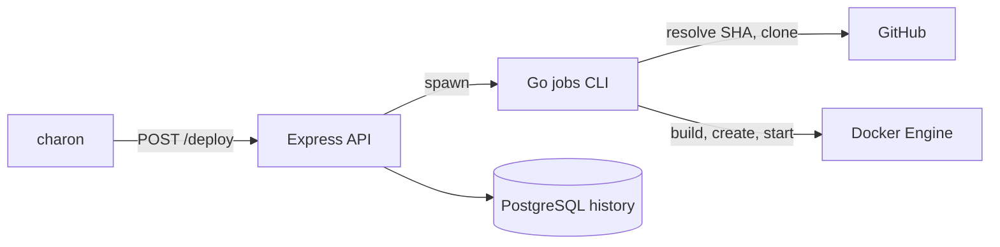

# thanatos

Backend for a small deploy manager, built for my engineering degree. Give it a repository, a branch and an environment, and it builds that commit into a Docker image and runs it as a container on the host.

The API is TypeScript. The deploy itself is a Go CLI that talks to the Docker Engine API directly. [charon](https://github.com/dfoltynski/charon) is the frontend, and [solaris](https://github.com/dfoltynski/solaris) is a minimal app used as a deploy target.

## How a deploy works



The Go CLI:

1. Takes an exclusive `flock` per environment, repo and branch, so concurrent deploys of the same target run one at a time.
2. Creates the Docker network for the environment if it is missing.
3. Resolves the branch head to a commit SHA, then clones and checks out that exact commit.
4. Builds an image tagged with the environment, repo and short SHA.
5. Reads the exposed port from the image, which must expose exactly one TCP port, and picks a free host port.
6. Replaces any existing container for that target, labelled with its env, repo, branch and SHA.
7. Waits for the container to run and for the port to accept TCP connections. On failure, it returns the tail of the container logs.

## Stack

- **API:** Node.js, Express, Zod, Passport (GitHub OAuth), PostgreSQL
- **Deploy job:** Go, Cobra, Moby client
- **Tooling:** TypeScript, ESLint, Prettier, Husky

## Run it

Requires Node (see `.nvmrc`), pnpm, Go, Docker and PostgreSQL.

```bash
cp .env.example .env   # fill in GitHub and database values
pnpm install
(cd src/modules/jobs && go build -o jobs .)
pnpm dev
```

## Known limits

This was built for my engineering degree, and these are the next things I would change:

- It runs on a single host, and the lock is a local file, so two hosts could deploy the same target at once.
- Replacing the old container before the new one is healthy means a short outage, and a failed deploy has no rollback. Blue-green would fix both.
- The health check only proves that the port accepts connections, not that the app works.
- There are no automated tests yet.
