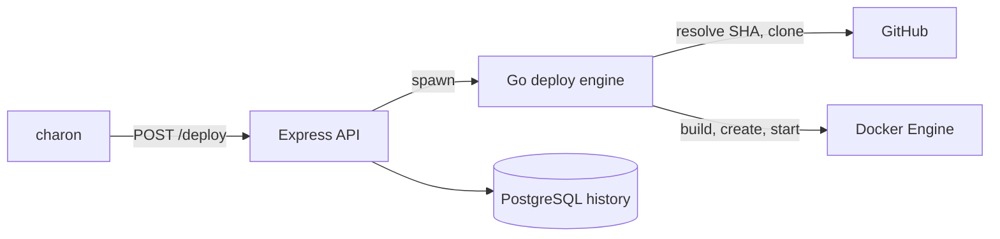

# thanatos

Deployment orchestrator that turns a repository, branch and environment into a running container. A TypeScript API handles authentication, validation and deploy history. A Go engine does the deploy, driving the Docker Engine API directly rather than the Docker CLI.

[charon](https://github.com/dfoltynski/charon) is the operator console, and [solaris](https://github.com/dfoltynski/solaris) is the test target. Designed and built for my engineering degree.

## How a deploy works



The Go engine:

1. Takes an exclusive `flock` per environment, repo and branch, so concurrent deploys of the same target run one at a time.
2. Creates the Docker network for the environment if it is missing.
3. Resolves the branch head to a commit SHA, then clones and checks out that exact commit.
4. Builds an image tagged with the environment, repo and short SHA.
5. Reads the exposed port from the image, which must expose exactly one TCP port, and picks a free host port.
6. Replaces any existing container for that target, labelled with its env, repo, branch and SHA.
7. Waits for the container to run and for the port to accept TCP connections. On failure, it returns the tail of the container logs.

## Stack

- **API:** Node.js, Express, Zod, Passport (GitHub OAuth), PostgreSQL
- **Deploy engine:** Go, Cobra, Moby client
- **Tooling:** TypeScript, ESLint, Prettier, Husky

## Run it

Requires Node (see `.nvmrc`), pnpm, Go, Docker and PostgreSQL.

```bash
cp .env.example .env   # fill in GitHub and database values
pnpm install
(cd src/modules/jobs && go build -o jobs .)
pnpm dev
```

## Design decisions

- **Commit-pinned builds.** The branch resolves to a SHA before cloning, so a deploy builds one exact commit even if the branch moves. Image tags and container labels record what is running.
- **Serialized deploys per target.** A kernel `flock` keyed on environment, repo and branch queues concurrent deploys of the same target, and the kernel releases it if the process dies.
- **Environment isolation.** Each environment gets its own Docker network.
- **Readiness gating.** A deploy only counts once the container is running and its port accepts TCP connections. On failure, the engine returns the tail of the container logs.
- **Separate deploy engine.** Builds run in a Go process outside the API, so the Node.js event loop stays free during long image builds.

## Roadmap

- Blue-green deploys with automatic rollback, to remove the replacement gap
- Distributed locking for multi-host deployments
- Application-level health probes alongside the TCP check
- Automated test suite
